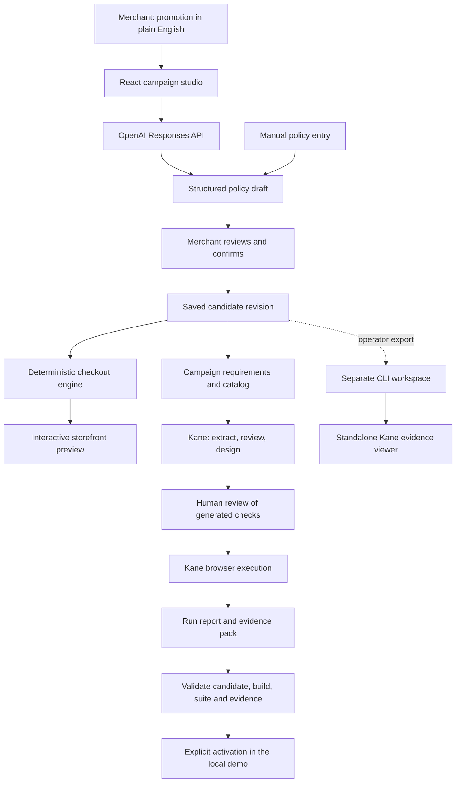

<div align="center">

# LaunchGate

### Make the promise. Prove the checkout.

<p>
  
  
  
  
  
</p>

**LaunchGate** helps merchants turn a promotion into a reviewed policy and check what customers will actually pay. OpenAI interprets the offer, deterministic code calculates checkout totals, and Kane CLI tests selected customer journeys in a real browser.

**Describe the offer. Review the policy. Check the checkout. Keep the evidence.**

[Architecture](#system-architecture) · [Workflow](#the-workflow-pipeline) · [Features](#features) · [Test Results](#recorded-test-results) · [Quick Start](#quick-start) · [API](#api-reference) · [Operator Guide](docs/KANE_OPERATOR_GUIDE.md)

</div>

---

## What Makes This Different

A promotion is a promise about price. LaunchGate connects that promise to a concrete policy, a customer checkout, and evidence for the revision being tested.

| Merchant question | LaunchGate's approach |
|---|---|
| What does my offer actually mean? | OpenAI proposes structured fields, followed by an editable policy review and plain-English summary. |
| What will a customer pay? | An interactive storefront calculates eligibility, discounts, caps, and totals using integer cents. |
| Which checkout behaviors should we check? | Kane derives use cases, criteria, and browser tests from the confirmed campaign requirements. |
| Who decides whether those checks are right? | A human reviews the journeys and generated checks before app-managed execution. |
| Does an old passing report still apply? | App-managed evidence is bound to the candidate, build, and reviewed suite; changes invalidate launch authorization. |
| How can I show the result? | A presentation view shows the offer and cart; standalone CLI evidence is presented separately in Kane's viewer. |

> **Prototype scope:** a local, single-user demo with a fixed catalog. Activation changes the demo's active policy; it does not publish to a commerce platform or process payments.

## System Architecture



The app-managed path can authorize activation. The separate CLI path supports developer testing and demonstrations; its reports do not automatically update the app's launch gate.

## The Workflow Pipeline

### 1. Define the offer

Start with a blank draft, or explicitly continue a saved promotion. Describe an offer such as:

> Give new customers 15% off non-sale merchandise when eligible items total at least $40, with savings capped at $10.

OpenAI proposes the policy fields. The merchant reviews and edits them before confirming. Manual entry is also available.

### 2. Preview the confirmed policy

Confirmation creates a saved revision. Adjust cart quantities and switch between new and returning customers to see the actual checkout calculation. The candidate preview and active store are separate views.

### 3. Prepare and review the checks

In the editing workspace, **Generate tests with Kane** sends the confirmed policy and demo catalog to Kane. Review the proposed journeys, approve the relevant use cases, then inspect the generated criteria, scenarios, test files, and coverage gaps. Nothing is auto-approved.

### 4. Verify and retain the evidence

Run the approved suite through the app, or export a separate operator workspace for CLI testing. Kane drives Chrome and records the results. A passing test proves its checked examples, not every possible cart or application behavior.

### 5. Present or activate

**Present this campaign** shows the confirmed offer and interactive cart. App-managed activation remains in the editing workspace and requires valid passing evidence for the current candidate and suite. Switching views never starts tests or changes approval.

## Features

### Promotion interpretation with human review

- OpenAI Responses API turns supported natural-language offers into structured policy fields.
- Editable review and a readable offer summary make the interpretation visible before confirmation.
- Known unsupported shipping, scheduling, rewards, tax, and bundle clauses are rejected conservatively.
- API credentials stay on the server. Manual entry and cart preview work without an OpenAI key.

### Deterministic checkout

- Monetary calculations use integer cents.
- Eligibility supports an inclusive minimum, a percentage discount, a maximum saving, new-customer restrictions, and sale-item exclusions.
- Cart quantities are integers from 0 through 20 per product.
- Catalog limits are disclosed, and an unreachable minimum is blocked.

### A reviewed suite for each revision

- Each candidate has its own requirements and assurance workspace.
- Approval binds the reviewed policy, requirements, test contents, and variable files to that revision.
- Editing reviewed files invalidates approval. Even identical policy numbers in a new revision require a new suite.
- Interrupted preparation preserves its workspace. Recovery can restore completed work or a saved question; restarting preserves the previous attempt.

### Evidence that keeps its scope

- Reports distinguish a live run, saved pass, failure or incomplete run, and stale evidence.
- App-managed activation checks the current revision, build, approved suite, and evidence integrity.
- Standalone CLI reports remain separate from app-managed launch authorization.
- Historical test fixtures are retained without being selected as the current campaign's runtime suite.

## Recorded Test Results

The recorded October 24, 2026 standalone checkout run tested **revision #3**: 15% off for new customers, a $40 eligible minimum, a $10 cap, and sale items excluded.

| Recorded result | Value |
|---|---|
| Browser tests | 8 passed, 0 failed, 0 broken, 0 skipped |
| Acceptance criteria | 14 of 14 proven for one checkout use case |
| CLI run duration | Approximately 4 minutes 11 seconds |
| Execution ID | `94f5e37a-91ee-41e4-9662-ca41f8f6d561` |

| Checkout example | Expected total |
|---|---:|
| Empty cart | $0.00 |
| New customer: Tote + Mug | $35.70 |
| New customer: Tote + Mug + Sale Cap | $50.70 |
| New customer: Hoodie + Mug, capped discount | $66.00 |
| Returning customer: Tote + Mug | $42.00 |
| Four Sale Caps, no eligible merchandise | $60.00 |
| Two Mugs, below the minimum | $36.00 |
| Twenty Mugs, capped discount | $350.00 |

**Coverage scope:** the 100% figure applies to those 14 criteria in one use case. It is not whole-app coverage, a CI status, or proof of the complete app-managed generation-to-activation workflow. These recorded results predate subsequent UI changes; they do not certify every later commit.

The local validation at code commit `aeca67e` also passed **16 unit tests** and the TypeScript/Vite production build. Run the commands below to check your current checkout.

## Tech Stack

| Layer | Technology | Responsibility |
|---|---|---|
| Frontend | React 18, Vite 8, TypeScript | Campaign studio, policy review, storefront, presentation |
| Backend | Express 4, TypeScript, tsx | API, OpenAI requests, workflow orchestration |
| AI interpretation | OpenAI Responses API | Propose a policy from supported plain-English offers |
| Validation | Zod | Policy and cart schemas |
| Pricing | Shared TypeScript functions | Deterministic eligibility, discounts, and totals |
| Browser assurance | Kane CLI | Requirements, use cases, test design, execution, evidence |
| Local persistence | JSON files and revision workspaces | Candidate state, approved suites, run metadata |
| Developer checks | Node test runner, TypeScript, Vite | Unit tests, type checking, production build |

## Project Structure

```text
LaunchGate/
├── src/
│   ├── main.tsx                 # Merchant workflow and presentation
│   ├── EvidencePanel.tsx        # Verification status and controls
│   └── style.css                # Application styling
├── server/
│   ├── index.ts                 # API and OpenAI integration
│   ├── state.ts                 # Revisions, fingerprints, activation gate
│   ├── assurance.ts             # Kane preparation, review, recovery
│   ├── kane.ts                  # Browser suite execution and result parsing
│   └── prepare-kane.ts          # Export a standalone operator workspace
├── shared/
│   ├── promotion.ts             # Policy schemas and checkout calculations
│   ├── campaign-scope.ts        # Supported requests and catalog limits
│   ├── merchant-flow.ts         # Form inputs and workflow guidance
│   └── evidence-status.ts       # Report status semantics
├── .testmuai/tests/             # Retained browser test definitions
├── requirements/
│   └── demo-campaign.md         # Historical demo campaign contract
├── docs/
│   ├── PRD.md                   # Product requirements
│   ├── IMPLEMENTATION_PLAN.md   # Implementation plan
│   └── KANE_OPERATOR_GUIDE.md   # CLI generation, review, execution, evidence
├── data/                       # Ignored local state and revision workspaces
└── .env.example                # Configuration template; no credentials
```

Unit tests live alongside the shared and server modules. Generated runtime artifacts and private evidence are excluded from Git.

## Quick Start

### Run the merchant app

Requires Node.js 20.19+ or 22.12+ and npm. Browser verification additionally requires Chrome and an authenticated Kane CLI 0.10.0 or newer.

```bash
git clone https://github.com/bhuvan1201/LaunchGate.git
cd LaunchGate
npm install
cp .env.example .env
```

Set `OPENAI_API_KEY` in your local `.env`. The template defaults to `OPENAI_MODEL=gpt-4o-mini` and `PORT=4173`. Do not commit credentials.

```bash
npm run dev
```

Open **http://127.0.0.1:4173**. Without an API key, use manual policy entry; AI interpretation will report a setup error.

### Validate the code

```bash
npm test
npm run build
```

To serve the production build locally after building:

```bash
npm start
```

### Prepare a demo without app-triggered Kane execution

```bash
KANE_EXECUTION_PAUSED=1 npm run dev
```

This disables app-triggered test preparation and execution with a visible notice. Drafting, OpenAI interpretation, confirmation, and cart preview remain available. It does not disable separate CLI commands.

### Test independently with Kane CLI

Confirm a campaign in the app, then export its requirements and preview URL:

```bash
npm run --silent kane:prepare
```

The exporter creates a separate workspace under `data/operator/` without calling Kane or approving tests. Follow the [Kane Operator Guide](docs/KANE_OPERATOR_GUIDE.md) to extract and review use cases, design checks, run individual tests or a suite, and inspect evidence.

Keep the confirmed candidate unchanged while testing and presenting it. Campaign URLs of the form `/?campaign=<revision>` resume only the matching current candidate.

## API Reference

These endpoints serve the local prototype. There is no merchant authentication or production tenancy boundary.

| Endpoint | Purpose |
|---|---|
| `GET /api/state` | Read current candidate, active policy, and workflow status |
| `POST /api/parse` | Ask OpenAI to interpret a supported promotion |
| `POST /api/confirm` | Confirm a policy as a candidate revision |
| `POST /api/quote` | Calculate checkout amounts |
| `POST /api/suite/generate` | Begin Kane preparation for the candidate |
| `POST /api/suite/review` | Submit human review of journeys or generated checks |
| `POST /api/suite/resume` | Continue preparation after answering a question |
| `POST /api/suite/recover` | Recover saved preparation work |
| `POST /api/suite/restart` | Preserve the old attempt and begin fresh preparation |
| `POST /api/suite/inputs` | Supply required browser-test inputs |
| `POST /api/verify` | Run the approved candidate suite |
| `POST /api/activate` | Activate the candidate when its evidence passes the gate |
| `GET /api/evidence` | Download the available app-managed evidence pack |

## Key Engineering Decisions

**1. AI proposes the policy; a human confirms it.**
The interpreted fields and offer summary are visible before confirmation. OpenAI is not the pricing calculator or the final authority on merchant intent.

**2. Checkout arithmetic stays deterministic.**
Shared code calculates eligibility, rounding, and caps using integer cents, so the same policy and cart yield the same amount.

**3. Approval belongs to a specific revision and suite.**
A policy change cannot inherit a previous campaign's approval. Reviewed file contents and build identity also matter when deciding whether evidence still authorizes launch.

**4. Test generation has human checkpoints.**
Kane derives the checks, while a person reviews their relevance and expected outcomes. Missing coverage remains visible instead of being treated as proof.

**5. Standalone testing and app-managed activation have separate records.**
An external passing report is useful demonstration evidence. It does not silently unlock the app's activation button.

**6. Preparation can recover without discarding its history.**
Interrupted sessions retain their workspaces and remain unapproved. Operators can inspect saved progress before retrying paid work.

## Domain Reference

### Demo catalog

| Product | Price | Sale item |
|---|---:|---|
| Canvas Tote | $24.00 | No |
| Ceramic Mug | $18.00 | No |
| Weekend Hoodie | $58.00 | No |
| Sale Cap | $15.00 | Yes |

### Policy rules

| Field | Supported behavior |
|---|---|
| Discount percentage | Whole-number percentage from 1 to 100 |
| Minimum eligible subtotal | Inclusive threshold; sale items excluded when configured |
| Maximum discount | Caps the calculated saving |
| New customers only | Returning customers receive no promotion when enabled |
| Exclude sale items | Sale items remain payable but do not contribute to eligible merchandise |

## Current Limits

- One shared local workspace, with no merchant accounts, real identity verification, payment processing, or commerce-platform integration.
- A fixed demo catalog and quantity limits; not every requested boundary is reachable.
- Natural-language interpretation still needs human review, including requests not caught by the unsupported-clause checks.
- Kane preparation and browser runs can take several minutes and consume credits. Provider outages or expired sign-in require operator attention.
- The entire generated design must be suitable before app approval; leave unsuitable checks unapproved.
- Do not run external Kane mutations inside a workspace currently used by the app. Use the separate operator export.
- Runtime evidence lives locally. Historical `verification-suite.json` and requirement tests are fixtures, not authorization for a new campaign.

## Builder

| Builder | Ownership |
|---|---|
| [Bhuvan Gowda](https://github.com/bhuvan1201) | Solo builder — product, merchant experience, OpenAI integration, Kane workflow, and demo |

Built for Kane CLI Hack Day, with OpenAI in the product and Kane CLI used for browser assurance.

<div align="center">

<sub>TypeScript · React · Vite · Express · OpenAI · Kane CLI</sub>

</div>
